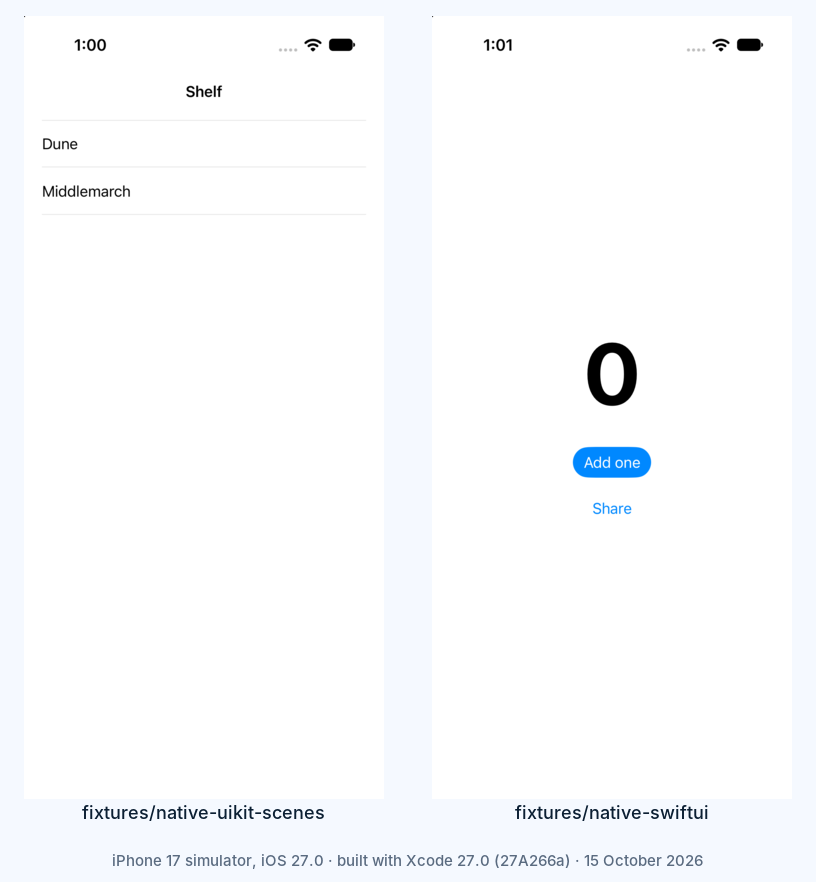

<!-- brand:start -->

<p align="center"><picture><source media="(prefers-color-scheme: dark)" srcset="https://raw.githubusercontent.com/muhittincamdali/sdkbump/main/.github/brand/banner-dark.svg"><source media="(prefers-color-scheme: light)" srcset="https://raw.githubusercontent.com/muhittincamdali/sdkbump/main/.github/brand/banner-light.svg"></picture></p>

<!-- lang-selector:start -->
<p align="center"><a href="README.md">English</a> · <a href="README.tr.md">Türkçe</a> · <a href="README.zh-CN.md">简体中文</a> · <a href="README.ja.md">日本語</a> · <a href="README.ko.md">한국어</a> · <a href="README.es.md">Español</a> · <a href="README.de.md">Deutsch</a> · <a href="README.fr.md">Français</a> · <a href="README.pt-BR.md">Português (Brasil)</a> · <a href="README.ru.md">Русский</a></p>
<!-- lang-selector:end -->

<p align="center">
<a href="https://github.com/muhittincamdali/sdkbump/actions/workflows/ci.yml"></a>
<a href="https://github.com/muhittincamdali/sdkbump/releases"><picture><source media="(prefers-color-scheme: dark)" srcset="https://raw.githubusercontent.com/muhittincamdali/sdkbump/main/.github/brand/badge-version-dark.svg"><source media="(prefers-color-scheme: light)" srcset="https://raw.githubusercontent.com/muhittincamdali/sdkbump/main/.github/brand/badge-version-light.svg"></picture></a>
<a href="https://github.com/muhittincamdali/sdkbump/blob/main/package.json"><picture><source media="(prefers-color-scheme: dark)" srcset="https://raw.githubusercontent.com/muhittincamdali/sdkbump/main/.github/brand/badge-language-dark.svg"><source media="(prefers-color-scheme: light)" srcset="https://raw.githubusercontent.com/muhittincamdali/sdkbump/main/.github/brand/badge-language-light.svg"></picture></a>
<a href="https://github.com/muhittincamdali/sdkbump/blob/main/LICENSE"><picture><source media="(prefers-color-scheme: dark)" srcset="https://raw.githubusercontent.com/muhittincamdali/sdkbump/main/.github/brand/badge-license-dark.svg"><source media="(prefers-color-scheme: light)" srcset="https://raw.githubusercontent.com/muhittincamdali/sdkbump/main/.github/brand/badge-license-light.svg"></picture></a>
</p>

<p align="center">
<a href="#quick-start"><picture><source media="(prefers-color-scheme: dark)" srcset="https://raw.githubusercontent.com/muhittincamdali/sdkbump/main/.github/brand/button-start-en-dark.svg"><source media="(prefers-color-scheme: light)" srcset="https://raw.githubusercontent.com/muhittincamdali/sdkbump/main/.github/brand/button-start-en-light.svg"></picture></a>
<a href="https://muhittincamdali.github.io/sdkbump/"><picture><source media="(prefers-color-scheme: dark)" srcset="https://raw.githubusercontent.com/muhittincamdali/sdkbump/main/.github/brand/button-docs-en-dark.svg"><source media="(prefers-color-scheme: light)" srcset="https://raw.githubusercontent.com/muhittincamdali/sdkbump/main/.github/brand/button-docs-en-light.svg"></picture></a>
<a href="https://github.com/muhittincamdali/sdkbump/tree/main/docs/guides"><picture><source media="(prefers-color-scheme: dark)" srcset="https://raw.githubusercontent.com/muhittincamdali/sdkbump/main/.github/brand/button-guides-en-dark.svg"><source media="(prefers-color-scheme: light)" srcset="https://raw.githubusercontent.com/muhittincamdali/sdkbump/main/.github/brand/button-guides-en-light.svg"></picture></a>
<a href="https://github.com/muhittincamdali/sdkbump/tree/main/examples"><picture><source media="(prefers-color-scheme: dark)" srcset="https://raw.githubusercontent.com/muhittincamdali/sdkbump/main/.github/brand/button-examples-en-dark.svg"><source media="(prefers-color-scheme: light)" srcset="https://raw.githubusercontent.com/muhittincamdali/sdkbump/main/.github/brand/button-examples-en-light.svg"></picture></a>
</p>

<!-- brand:end -->

Before you ship a build made with Xcode 27: sdkbump checks a native iOS, Flutter or React
Native/Expo project for what the iOS 27 SDK changes, starting with the UIScene life cycle, and
tells you which fix applies to each finding. It reads your project's files; it does not build,
run or change anything.

<picture><source media="(prefers-color-scheme: dark)" srcset="docs/media/demo-rn-087-dark.svg"><source media="(prefers-color-scheme: light)" srcset="docs/media/demo-rn-087-light.svg"></picture>

<sub>Recorded from the real CLI on the <a href="fixtures/rn-087">rn-087 fixture</a>, a React
Native 0.87.1 app from <code>@react-native-community/cli init</code> (<code>npm run demo</code>).</sub>

## Highlights

- **Answers "will it launch?"** An app that declares no scene builds with Xcode 27 and then stops
  at launch. sdkbump says so before you find out on a test device, and names the files to change.
- **Native, Flutter, React Native and Expo** in one report with the same rule IDs, as text,
  Markdown or JSON, and an exit code for CI.
- **The fix that applies to your project**: React Native 0.88 or a hand-written scene delegate,
  Expo SDK 57's opt-in or SDK 58, Flutter's automatic migration or the manual steps (sdkbump
  checks the same conditions as Flutter's migrator), or the SwiftUI API for a SwiftUI app.
- **Quiet breakage too**: app delegate methods and launch options UIKit stops using once the app
  has a scene (links, Handoff, quick actions, foreground and background), and window lookups that
  no longer find the right window.
- **Every statement has a source.** The rules are data ([rules/ios27.json](rules/ios27.json)) and
  each one cites Apple's, Flutter's, React Native's or Expo's own pages; the tests fail if one
  does not.
- **Checked in the iOS 27 simulator**: the launch failure and the black screen behind SCN001 and
  SCN002 were reproduced with Xcode 27.0, and the recordings are in the repository.

## Quick start

You need [Node.js](https://nodejs.org/) 22.12 or later (`node --version` prints it; on a Mac,
`brew install node` installs it). Nothing else.

**1. Open a terminal in your app's folder**, the one with the `.xcodeproj`, `pubspec.yaml` or
`package.json`:

```sh
cd path/to/YourApp
```

**2. Run sdkbump:**

```sh
npx https://github.com/muhittincamdali/sdkbump/releases/download/v0.1.1/sdkbump-0.1.1.tgz
```

sdkbump is not on npm yet (publishing it there is planned), so `npx sdkbump` does not work for
now. The command above runs the 0.1.1 release from GitHub; use it wherever this README says
`npx sdkbump`.

**3. Read the first line under your project's name.** "Fails to launch when built with the iOS 27
SDK" means the app stops at launch until you fix the **ERROR** findings; each one says which fix
from the "How to fix" list applies. **WARNING** findings do not stop the launch but stop working
once the app has a scene. "Launch not determined" means sdkbump could not read an Info.plist; the
notes at the end of the report say which one and why (see Limits below).

## What changes when you build with the iOS 27 SDK

From Apple's
[Transitioning to the UIKit scene-based life cycle](https://developer.apple.com/documentation/uikit/transitioning-to-the-uikit-scene-based-life-cycle):

> Beginning in iOS 27, iPadOS 27, Mac Catalyst 27, tvOS 27, and visionOS 27, apps built with the
> latest SDK must adopt the scene-based life cycle or they fail to launch.

1. **The app stops at launch if it declares no scene.** No `UIApplicationSceneManifest` with a
   configuration in Info.plist and no `application(_:configurationForConnecting:options:)`: UIKit
   ends the process with "UIScene life cycle is required for apps built with this SDK". The
   compiler does not warn, because the check runs when the app starts. React Native 0.87 and
   earlier, Expo SDK 57 without its opt-in and Expo SDK 56 and earlier create apps like this; so do
   Flutter apps that the Flutter tool cannot migrate.
2. **With a scene, the app delegate stops receiving UI events.** Links, user activities, quick
   actions and the active/background transitions go to the scene delegate, and a window the app
   delegate creates is never shown.

[Why it compiles and still crashes](docs/guides/why-it-crashes.md) shows the
[launch matrix](examples/launch-matrix/README.md) we ran in the iOS 27.0 simulator.

## What sdkbump checks

| Rule   | Severity | Finding                                                                                                                                                                                     | Seen in the iOS 27.0 simulator                                  |
| ------ | -------- | ------------------------------------------------------------------------------------------------------------------------------------------------------------------------------------------- | --------------------------------------------------------------- |
| SCN001 | error    | No scene configuration: no configured `UIApplicationSceneManifest`, no `configurationForConnecting`, not a SwiftUI `App`; for Expo without `ios/`, the SDK version and `enableSceneSupport` | stops at launch                                                 |
| SCN002 | error    | The app delegate creates the window with `UIWindow(frame:)`                                                                                                                                 | black screen once the app has a scene                           |
| SCN003 | warning  | App delegate methods and launch option keys UIKit no longer uses with scenes (13 of them), unless the scene delegate already handles them                                                   | `applicationDidEnterBackground(_:)` not called in a SwiftUI app |
| SCN004 | warning  | Window lookups through `UIApplication.shared.keyWindow`, `.windows` or the app delegate's `window`                                                                                          | compiler deprecation warnings only                              |

Rule data `ios27@2026.10.15`, checked against Xcode 27.0 (27A266a). When React Native or Expo has
`react-native-uiscene-bridge` or `react-native-xcode27` installed, the findings it handles at run
time are shown as handled, with the limits from its README, and do not fail the run.

## Installation

sdkbump is not on npm yet; publishing it there is planned. Until then, run the 0.1.1 release from
GitHub as shown above, or add it to a project:

```sh
npm install --save-dev https://github.com/muhittincamdali/sdkbump/releases/download/v0.1.1/sdkbump-0.1.1.tgz
npx sdkbump
```

Once sdkbump is on npm, `npx sdkbump` downloads and runs the latest version, and
`npm install --save-dev sdkbump` pins one. A Homebrew formula for `muhittincamdali/tap` is
prepared by the release workflow (planned with the first release of the tap).

## Usage

```text
sdkbump [path] [options]
```

| Option                  | What it does                                                               |
| ----------------------- | -------------------------------------------------------------------------- |
| `path`                  | Project folder or `.xcodeproj`; default is the current folder              |
| `-f, --format <format>` | `tty` (default), `markdown` or `json`                                      |
| `-o, --output <file>`   | Write the report to a file instead of the terminal                         |
| `--fail-on <severity>`  | `error` (default), `warning`, `info` or `none`: when the exit code is 1    |
| `--no-color`            | Plain text even in a terminal (`NO_COLOR` and `FORCE_COLOR` are respected) |

Exit codes: `0` nothing unhandled at or above `--fail-on`, `1` findings at or above it, `2` bad
arguments, no iOS project found, or an unexpected error.

sdkbump finds the iOS app on its own: an `.xcodeproj` at the root or one folder down for native
apps, `ios/` for Flutter, React Native and Expo apps (`example/ios/` for a Flutter plugin). It
reads every iOS app target in the project file, the Info.plist each one names (XML or binary),
and the Swift and Objective-C files of the app, skipping Pods, `node_modules`, build output and
tests. Expo apps without `ios/` are checked from package.json and app.json.

### Keep a Markdown report with the code

```sh
npx sdkbump --format markdown --output sdkbump.md
```

### Use the JSON report in scripts

```sh
npx sdkbump --format json > sdkbump.json
```

Each finding has `rule`, `severity`, `file`, `line`, `message`, the `fix` with its steps and guide,
`alternatives`, `mitigation` (set when a workaround package handles it) and `sources`. The layout
is `schemaVersion` 0 and may change before 1.0.
[examples/shell/launch-blockers.sh](examples/shell/launch-blockers.sh) filters it with `jq`.

### Run it in CI

[examples/github-actions/sdkbump.yml](examples/github-actions/sdkbump.yml) adds the report to the
job summary of every pull request that touches the iOS app and fails the job on errors.

### From JavaScript

```js
import { render, scan } from 'sdkbump';

const report = await scan('path/to/app');
console.log(report.verdict.text);
console.log(render(report, 'markdown'));
```

A runnable version is [examples/api/verdicts.mjs](examples/api/verdicts.mjs).

## Demo

The terminal recordings come from the CLI on the [fixtures](fixtures/README.md), real projects
made with each toolchain:

| Project                                                  | Recording                                                                             |
| -------------------------------------------------------- | ------------------------------------------------------------------------------------- |
| React Native 0.87.1 app                                  | top of this page                                                                      |
| Flutter app with a customised AppDelegate (Flutter 3.24) | [light](docs/media/demo-flutter-light.svg) · [dark](docs/media/demo-flutter-dark.svg) |
| SwiftUI app with an adaptor app delegate                 | [light](docs/media/demo-swiftui-light.svg) · [dark](docs/media/demo-swiftui-dark.svg) |

In the iOS 27.0 simulator (iPhone 17, built with Xcode 27.0), the native UIKit fixture stops at
launch and the same app moved to a scene delegate launches:

<picture><source media="(prefers-color-scheme: dark)" srcset="docs/media/demo-simulator-native-uikit-dark.svg"><source media="(prefers-color-scheme: light)" srcset="docs/media/demo-simulator-native-uikit-light.svg"></picture>

<p align="center"></p>

Measured on 15 October 2026 on a Mac (Apple silicon, M5 Max) with Node.js 26.11 while other jobs
were running on it: three sets of 100 runs of `node dist/cli/main.js` on the ten fixtures, Node.js
start-up included. The medians of the three sets were 0.11, 0.12 and 0.19 seconds; the slowest
run took 0.33 seconds. A busier machine gives longer times.

## Status

| Feature                                                                                       | Status        |
| --------------------------------------------------------------------------------------------- | ------------- |
| Native, Flutter (app and plugin example), React Native and Expo project detection             | works         |
| SCN001 to SCN004 on the app's own Info.plist and Swift/Objective-C sources                    | works         |
| Fix selection by ecosystem and version; Flutter auto-migration check; workaround packages     | works         |
| Terminal, Markdown and JSON reports; `--fail-on` exit codes                                   | works         |
| Dependencies: Pods, `node_modules` and Flutter plugin sources, with the package named         | planned (0.2) |
| SCN005 workaround notice as its own rule; DPT001 deployment targets below 15.0                | planned (0.2) |
| `--verify`: build and launch in the iOS 27 simulator from the CLI                             | planned (0.3) |
| Swift/Objective-C syntax trees instead of patterns; built `.app` checks; SiriKit deprecations | planned (0.5) |
| `fix --dry-run` for native apps, SARIF output, GitHub Action                                  | planned (0.8) |
| Stable rule schema and JSON layout                                                            | planned (1.0) |

## Limits

- **Patterns, not a compiler.** The rules are regular expressions over Swift and Objective-C text
  whose comments and strings are blanked. Code that is generated, hidden behind macros or written
  in an unusual shape can be missed or matched by mistake. Syntax trees are planned (0.5).
- **Only the app's own sources.** Pods, `node_modules`, Flutter plugins and other dependencies are
  not read, so a plugin that relies on app delegate methods UIKit no longer calls is not reported.
  Dependency checks are planned (0.2).
- **Build settings from project.pbxproj only.** sdkbump reads `INFOPLIST_FILE` and
  `GENERATE_INFOPLIST_FILE` from the project file and expands `$(SRCROOT)`, `$(PROJECT_DIR)`,
  `$(TARGET_NAME)` and `$(PRODUCT_NAME)`. It does not read `.xcconfig` files or expand other build
  settings, and it does not read an Info.plist outside the project folder. When it cannot read a
  target's Info.plist, SCN001 is an info finding and the verdict is "Launch not determined"
  instead of a guess.
- **No suppression file.** A finding cannot be marked as reviewed; `--fail-on` decides which
  severities fail the run.
- **Files only.** sdkbump does not build or launch the app; `--verify` is planned (0.3).

## Documentation

API reference and guides: [muhittincamdali.github.io/sdkbump](https://muhittincamdali.github.io/sdkbump/).

## Guides

- [Why it compiles and still crashes](docs/guides/why-it-crashes.md)
- [Native UIKit and SwiftUI apps](docs/guides/native-ios.md)
- [Flutter: a custom AppDelegate and plugins](docs/guides/flutter.md)
- [React Native before 0.88 and Expo before SDK 58](docs/guides/react-native-expo.md)
- [Native module authors: links and notifications at cold start](docs/guides/native-module-authors.md)

## Related tools

Other projects work on the same change; which one fits depends on what you need:

- [react-native-uiscene-bridge](https://github.com/Atomics-hub/react-native-uiscene-bridge) and
  [react-native-xcode27](https://github.com/Atomics-hub/react-native-xcode27) make a React Native
  or Expo app launch without code changes, at run time. They fit when you cannot upgrade yet;
  sdkbump recognises them.
- [auditor-uiscene](https://github.com/Anzell/auditor-uiscene) audits Flutter apps and their
  plugins with a shell script.
- Flutter's own migrator (`flutter build ios` from 3.41) migrates an unmodified Flutter app.
- [flutter_spm_doctor](https://pub.dev/packages/flutter_spm_doctor) checks Flutter plugins.

## Requirements

| Toolchain | Minimum version |
| --------- | --------------- |
| Node.js   | 22.12           |

sdkbump does not need Xcode: it reads files, so it also runs on Linux. CI runs the tests on
Node.js 22 and 24 (Linux); locally all 269 pass on Node.js 22.23, 24.22 and 26.11 on a Mac (Apple
silicon). The simulator recordings need a Mac with Xcode 27 and are not part of CI.

## Architecture

```text
path ─► detectProject      native | flutter | react-native | expo; iOS folder; versions
     ─► collectApp         iOS app targets from project.pbxproj, their Info.plist (XML or binary),
                           Swift and Objective-C sources with comments and strings blanked
     ─► checkApp           SCN001…SCN004, fix per ecosystem and version, workaround packages
          rules/ios27.json  what each rule says, fixes, sources (validated with zod)
     ─► render             tty | markdown | json
```

- Detection patterns are regular expressions over source text whose comments and strings are
  blanked, and only count inside an app delegate or scene delegate where that matters.
- The rule data is separate from the code and versioned (`ios27@2026.10.15`); a test fails when a
  rule, fix or workaround has no source.
- The CLI (`src/cli/`) only parses arguments, picks colours and widths, and sets the exit code.

## Roadmap

See the [Status](#status) table: 0.2 adds dependencies and deployment targets, 0.3 launching in
the simulator from the CLI, 0.5 syntax trees and built-app checks, 0.8 fixes and SARIF, 1.0 a
stable schema. [CHANGELOG.md](CHANGELOG.md) lists what each release changed.

## FAQ

**My app runs on iOS 27 today. Is it affected?** If it was built with Xcode 26 or earlier, the
check does not apply to that build: in our run the same code linked against the iOS 26 SDK
launched on the iOS 27 simulator. It applies to your next build with Xcode 27.

**Does sdkbump replace testing on a device?** No. It reads files. The simulator recordings in this
repository are from the iOS 27.0 simulator; nothing here was run on a device.

**Why is a finding "handled"?** A workaround package in package.json (react-native-uiscene-bridge
or react-native-xcode27) declares a scene at run time. The app launches, but it still has no scene
support of its own; the report lists the package's limits and the real fix.

**Does sdkbump change my project?** No. It reads it and writes only the report you ask for.

## Contributing

Contributions are welcome: read [CONTRIBUTING.md](CONTRIBUTING.md) and the
[code of conduct](https://github.com/muhittincamdali/.github/blob/main/CODE_OF_CONDUCT.md) before
opening a pull request, and report security issues as described in [SECURITY.md](SECURITY.md).

## License

Released under the MIT license. See [LICENSE](LICENSE).
