# Why it compiles and still crashes

An app that never adopted UIKit scenes builds with Xcode 27 without an error, and then stops the
moment it opens. This page shows what UIKit checks, when, and what we saw in the iOS 27 simulator.

## What Apple says

From [Transitioning to the UIKit scene-based life cycle](https://developer.apple.com/documentation/uikit/transitioning-to-the-uikit-scene-based-life-cycle):

> Beginning in iOS 27, iPadOS 27, Mac Catalyst 27, tvOS 27, and visionOS 27, apps built with the
> latest SDK must adopt the scene-based life cycle or they fail to launch.

The same article lists two signs that an app still needs to migrate: Info.plist has no
`UIApplicationSceneManifest` (or one with no configurations), and the app delegate does not
implement `application(_:configurationForConnecting:options:)`. iOS 18.4 started logging
"This process does not adopt UIScene lifecycle"; iOS 26 changed it to "UIScene lifecycle will soon
be required".

## Why the compiler does not catch it

The check is not in the compiler or the linker. It runs inside UIKit when the app starts, and it
looks at two things: whether the app declares a scene, and which SDK the app was linked against.
Nothing about the app's code is wrong in Swift terms, so Xcode builds it. In the native-uikit
fixture the only warnings are the deprecations of `keyWindow` and `windows`; the app delegate
methods that stop working under scenes compile without a word.

## What the iOS 27 simulator shows

Each row is a minimal app, built and launched on 15 October 2026 with Xcode 27.0 (27A266a) on the
iOS 27.0 simulator runtime (24A434), Mac (Apple silicon). The apps and the script that builds and
launches them are in [examples/launch-matrix](https://github.com/muhittincamdali/sdkbump/tree/main/examples/launch-matrix); each app logs how many
visible windows belong to a connected scene one second after launch.

| App                                                                                  | Linked SDK | Result                                    |
| ------------------------------------------------------------------------------------ | ---------- | ----------------------------------------- |
| A. No scene manifest, no `configurationForConnecting`                                | 27.0       | stops at launch                           |
| B. Manifest with `UIApplicationSupportsMultipleScenes` only, no configurations       | 27.0       | stops at launch                           |
| C. No manifest, `configurationForConnecting` returns a scene delegate                | 27.0       | launches, 1 visible window in a scene     |
| D. SwiftUI `App`, no manifest                                                        | 27.0       | launches, 1 visible window in a scene     |
| E. Configuration naming a class that does not exist; window made in the app delegate | 27.0       | launches, no visible window: black screen |
| F. Same as A                                                                         | 26.0       | launches, 1 visible window in a scene     |
| G. Scene delegate that makes no window; window made in the app delegate              | 27.0       | launches, no visible window: black screen |
| H. Configuration without a delegate class; window made in the app delegate           | 27.0       | launches, no visible window: black screen |
| I. The manifest Xcode generates: multiple scenes, empty `UISceneConfigurations`      | 27.0       | stops at launch                           |

A, B and I stop with `EXC_BREAKPOINT (SIGTRAP)` in
`_UIApplicationEvaluateRuntimeIssueForNoSceneLifecycleAdoption`, before
`application(_:didFinishLaunchingWithOptions:)` runs, and the system log has:

```text
(UIKitCore) failure in void _UIApplicationEvaluateRuntimeIssueForNoSceneLifecycleAdoption(void)_block_invoke (UIApplication_RuntimeIssues.m:106) : Application failed to launch: UIScene life cycle is required for apps built with this SDK. See "Transitioning to the UIKit scene-based life cycle" in the UIKit documentation for more information on migration.
```

F is A's code with the linked SDK version recorded as 26.0: it launches on the same iOS 27
simulator. That matches Apple's wording, "apps built with the latest SDK": the check depends on the
SDK the app was linked against, not only on the iOS version it runs on.

E, G and H explain SCN002: once a scene exists, a window the app delegate creates with
`UIWindow(frame:)` belongs to no scene and is never shown.

## The same on a real project layout

The [native-uikit](https://github.com/muhittincamdali/sdkbump/tree/main/fixtures/native-uikit) fixture (an XcodeGen project with an app delegate
life cycle) and [native-uikit-scenes](https://github.com/muhittincamdali/sdkbump/tree/main/fixtures/native-uikit-scenes) (the same app moved to a
scene delegate) built with `xcodebuild`:

<picture><source media="(prefers-color-scheme: dark)" srcset="../media/demo-simulator-native-uikit-dark.svg"><source media="(prefers-color-scheme: light)" srcset="../media/demo-simulator-native-uikit-light.svg"></picture>

<picture><source media="(prefers-color-scheme: dark)" srcset="../media/demo-simulator-native-uikit-scenes-dark.svg"><source media="(prefers-color-scheme: light)" srcset="../media/demo-simulator-native-uikit-scenes-light.svg"></picture>

To run it yourself on a Mac with Xcode 27 and XcodeGen:

```sh
scripts/simulator-check.sh native-uikit
scripts/simulator-check.sh native-uikit-scenes
```

The script creates its own simulator named `sdkbump-iPhone-17` the first time and leaves your
other simulators alone.

## What sdkbump checks for it

- **SCN001** is the launch failure: no configured scene manifest, no `configurationForConnecting`
  in an app delegate, and not a SwiftUI `App`.
- **SCN002** is the black screen: the app delegate creates its own window.
- **SCN003** and **SCN004** do not stop the launch. They are the app delegate methods, launch
  options and window lookups that quietly stop working once the app has a scene.

None of this was tested on a device; all results above are from the iOS 27.0 simulator.
